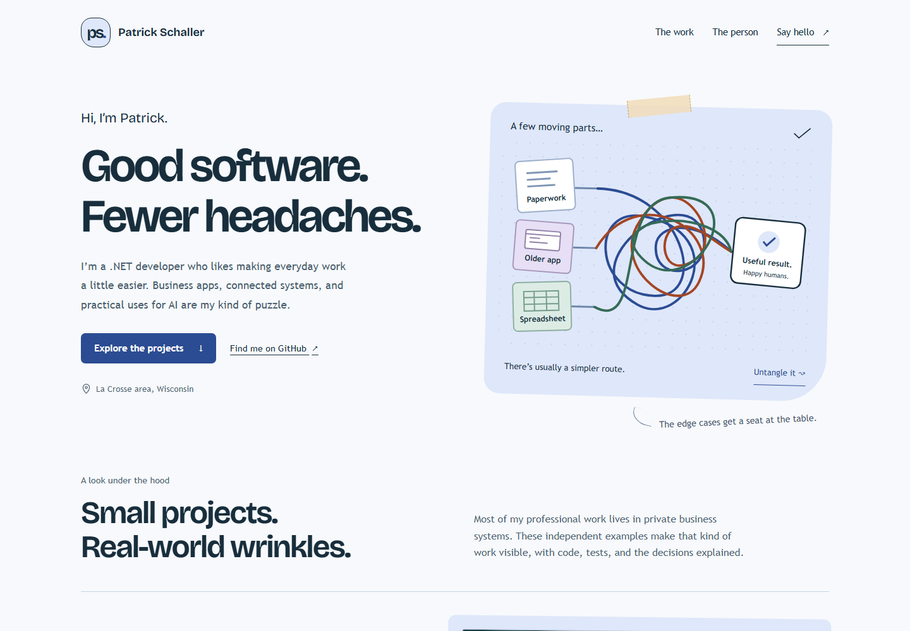

# Patrick Schaller — portfolio

[](https://github.com/PatrickSchaller/patrickschaller.github.io/actions/workflows/pages.yml)

**[patrickschaller.github.io](https://patrickschaller.github.io/)**

A small, static portfolio for prospective employers and professional contacts. The tone is practical and friendly, with an original workflow illustration that untangles on request. No framework, production dependencies, analytics, cookies, forms, accounts or backend.



## Work on it

Requires Node.js 22 or newer for the local tools. The actual site is plain HTML, CSS and a little JavaScript.

```sh
npm run dev
```

Open **http://127.0.0.1:5100**. Edit `site/index.html`, `site/styles.css` and `site/script.js`. Local serving uses Node's standard library and does not require installing packages.

## Check it

```sh
npm ci --ignore-scripts
npm run check
npx playwright install chromium
npm test
```

The static check verifies internal file/anchor links, image dimensions and the contact route. Seven browser checks cover loaded assets, project links, disclosure controls, email, keyboard interaction, reduced motion, layouts from 320px to desktop, and core content with JavaScript disabled. These checks are not a complete assistive-technology audit.

To refresh the documentation screenshots, start the local server and run `npm run screenshots`.

## Publish

The workflow checks the site before publishing **only the `site/` folder** to GitHub Pages. Development tools, packages and documentation are not included in the deployment. Push to `main` to update the public site. Repository Settings → Pages uses **GitHub Actions** as the source.

## Content and assets

- Contact: the email supplied for publication by Patrick. There is a `mailto:` link, not a message-collection form.
- Four independent, AI-assisted example projects are linked to their source repositories. Their synthetic-data scope and live-AI limits remain visible.
- Project screenshots come from the public Inventory Receiving and Label Review examples, using invented data. No private work screenshots or employer assets are used.
- The SVG workflow and monogram are original code-drawn artwork. The interaction is an illustration, not a working business-system integration.
- [Bricolage Grotesque](https://github.com/google/fonts/tree/main/ofl/bricolagegrotesque) is self-hosted under its [SIL Open Font License](site/assets/bricolage-OFL.txt). Other text uses system fonts. Visitors do not request external fonts.
- No personal photograph, unprovided career history, client endorsements or business outcome claims are included.

Site implementation and writing were produced with AI assistance using Patrick's supplied background and preferences. Code and original artwork are MIT licensed; the included font retains its own license.
